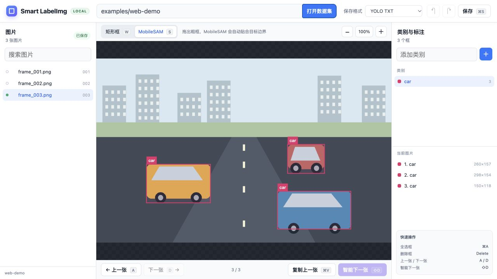

# Smart LabelImg Web

A local browser workspace for image bounding-box annotation, with **YOLO TXT**, **Pascal VOC XML**, and optional **MobileSAM** refinement. Images, inference, and annotation files stay on your computer. The interface is currently in Chinese.



*Captured from the running application. The included road scenes are original synthetic illustrations, not model benchmarks.*

## Start

Download the [web release](https://github.com/yifan-2004/Smart-LabelImg/releases/latest) and extract it. Install **Python 3.11+**, then run from the project folder:

```bash
# macOS / Linux
./setup_web.sh
./run_web.sh
```

```powershell
# Windows
.\setup_web.ps1
.\run_web.ps1
```

Open **http://127.0.0.1:7860** if the browser does not open automatically. Stop the server with `Ctrl+C`. No desktop `.app` or `.exe` is needed.

Manual annotation works without AI packages. For MobileSAM, use Python 3.11 and run `./setup_web.sh --ai` or `.\setup_web.ps1 -AI`. The checkpoint is included; installing dependencies requires internet access.

## Annotate in four steps

1. Enter a local image-folder path and click **Open dataset**. Try `examples/web-demo` first.
2. Choose **YOLO TXT** or **Pascal VOC XML**, then select or add a class.
3. Drag to draw a box. Click a box to move it; drag a corner to resize it. MobileSAM mode refines a rough box locally.
4. Edits auto-save beside each image; check the saved status before leaving. YOLO also writes `classes.txt`. Keep a backup of existing labels.

**Smart next** propagates boxes to the next frame and refines them. Low-confidence candidates require `Enter`; review all suggestions. Existing target annotations are preserved.

## Shortcuts

Use `Cmd` on macOS or `Ctrl` elsewhere for the modifier below.

| Key | Action |
|---|---|
| `W` / `S` | Rectangle / MobileSAM mode |
| `A` / `D` | Previous / next image |
| `Shift+D` | Smart next frame |
| `Cmd/Ctrl+V` | Copy previous image's boxes |
| `Cmd/Ctrl+A` | Select all boxes |
| `Delete` / `Backspace` | Delete selected boxes |
| Arrow keys | Move selected boxes by one pixel |
| `Cmd/Ctrl+Z` / `Cmd/Ctrl+Shift+Z` | Undo / redo |
| `Cmd/Ctrl+S` / `Cmd/Ctrl+0` | Save / fit image |
| `Enter` | Accept pending propagation candidates |

See [setup, troubleshooting, and validation](docs/local-web.md) for details. This is a single-user local application; do not expose the server publicly.

## License

[MIT](LICENSE) · [LabelImg](https://github.com/HumanSignal/labelImg) · [MobileSAM](https://github.com/ChaoningZhang/MobileSAM) · [Third-party notices](THIRD_PARTY_NOTICES.md)
